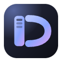
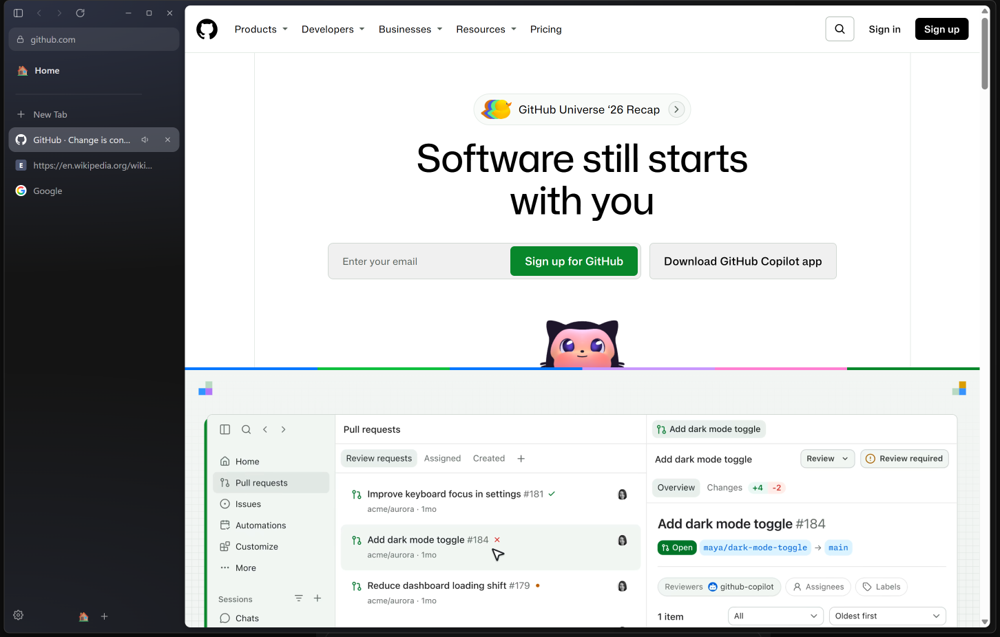
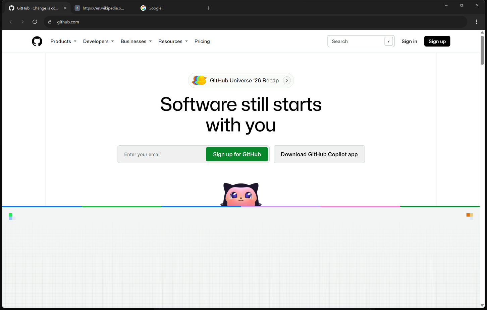
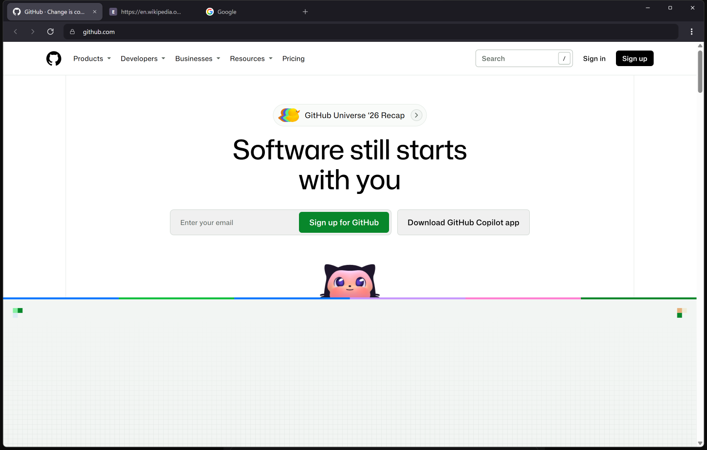
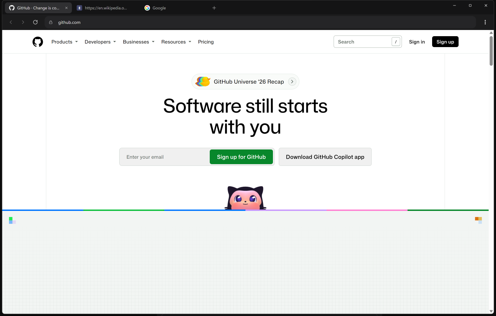
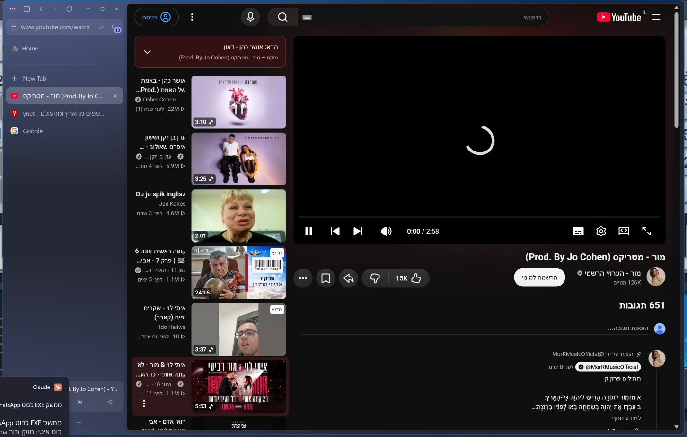
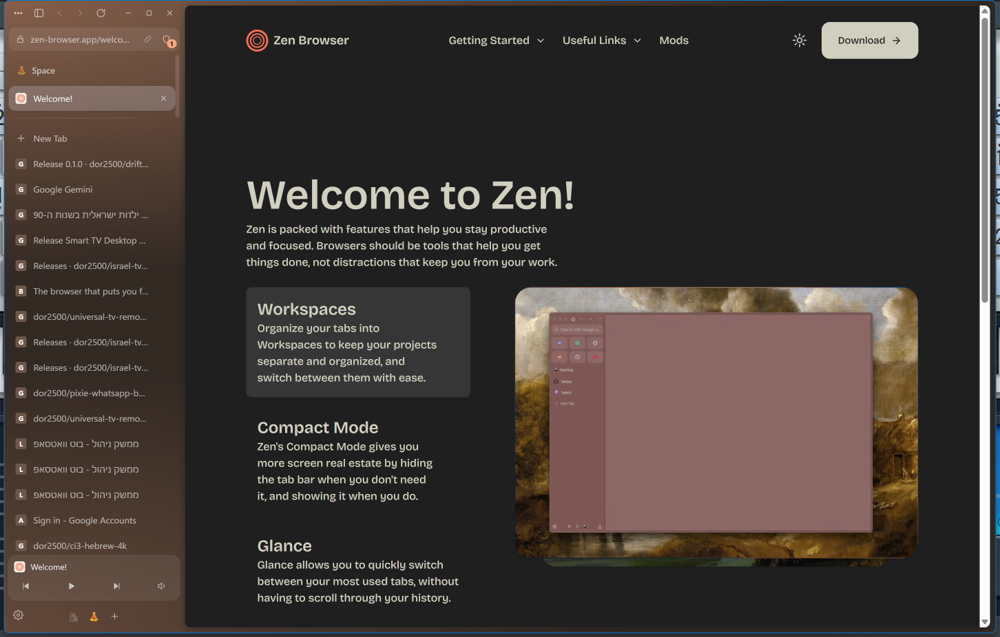
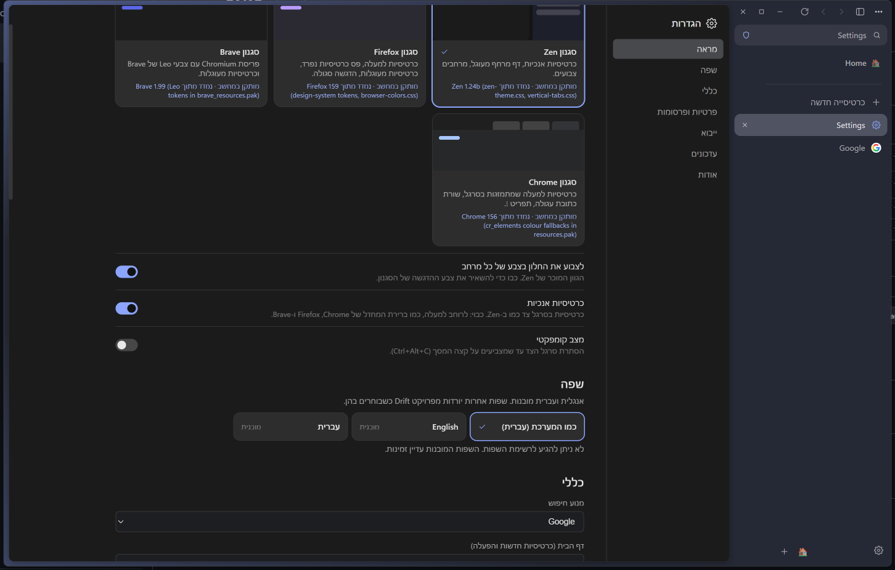
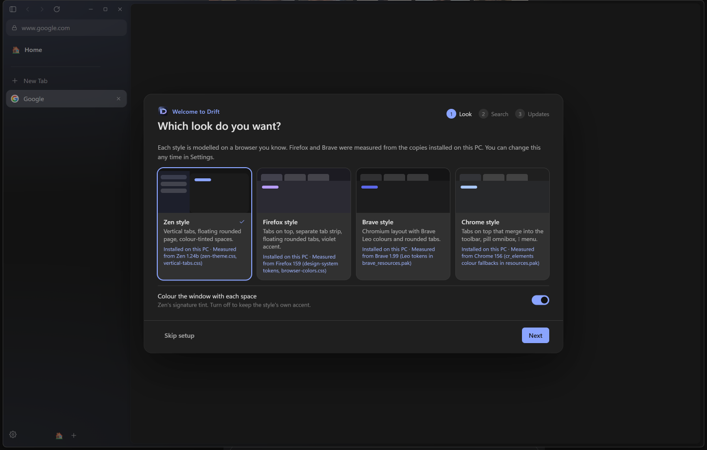
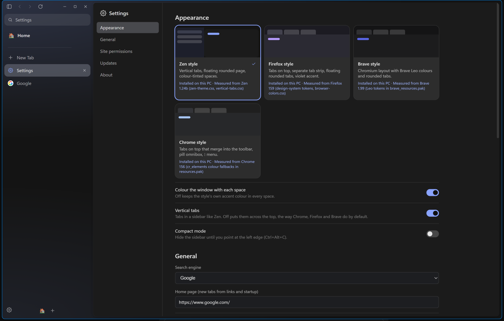

<p align="center"></p>

<h1 align="center">Drift</h1>

<p align="center">A dark, minimal Chromium browser with Zen-style vertical tabs, spaces, split view and Glance, plus Chrome, Firefox and Brave styles, a built-in ad blocker and automatic Chromium security updates.</p>

<p align="center"></p>

## Install

**Windows**, in PowerShell:

```powershell
irm https://raw.githubusercontent.com/dor2500/drift-browser/main/install.ps1 | iex
```

**macOS / Linux**, in a terminal:

```bash
curl -fsSL https://raw.githubusercontent.com/dor2500/drift-browser/main/install.sh | sh
```

Or download `Drift-Setup-x.y.z.exe` (Windows), the `.dmg` (macOS) or the `.AppImage` / `.deb` (Linux) from [Releases](https://github.com/dor2500/drift-browser/releases/latest). Installed copies update themselves. Builds aren't code-signed yet, so Windows SmartScreen may say "More info → Run anyway", and on macOS the install script clears the download-quarantine flag.

## Features

- **Four styles, each with its browser's real layout.** Colours and shapes were measured from the copies installed on the developer's PC:

  | Zen | Chrome |
  |---|---|
  |  |  |
  | **Firefox** | **Brave** |
  |  |  |

- **Vertical tabs, Essentials, pinned tabs, Spaces** (swipe or Ctrl+Alt+←/→), **compact mode**, **split view** and **Glance** (Alt+click a link to preview it).
- **Built-in ad and tracker blocking.** EasyList, EasyPrivacy and uBlock filters plus a YouTube ad skipper. The shield in the address bar shows the blocked count and pauses blocking per site.

  

- **Import from Zen, Firefox, Chrome, Brave and Edge.** Bookmarks and history become address-bar suggestions. From Zen, your spaces, pinned tabs, Essentials and open tabs come across too.

  

- **Media controls** in the sidebar for whatever is playing.
- **Permission prompts** for camera, microphone, location and notifications, with per-site answers you can change from the lock icon.
- **Languages:** English and Hebrew built in (Hebrew lays out right to left). More languages download on demand from [`locales/`](locales/).

  

- **First-run setup** for style, import, search engine and update source, and a **settings page** for everything.

  | First run | Settings |
  |---|---|
  |  |  |

## Updates and Chromium security

Drift's engine is the Chromium inside Electron. Electron ships each new Chromium about every 8 weeks, with security fixes backported in between.

- `.github/workflows/engine-watch.yml` runs **every day**. When a newer stable Electron is out, it upgrades Drift, bumps the version and publishes a release.
- `.github/workflows/release.yml` builds Windows, macOS and Linux and publishes one GitHub Release. Installed copies download it in the background and install it on restart.
- To publish your own release:

  ```bash
  npm version patch
  ```

  ```bash
  git push --follow-tags
  ```

## Develop

```bash
npm install
npm run dev              # Vite + HMR for the UI, launches Electron
npm run build && npm start
npm run update-engine    # newest Electron/Chromium (add --dry-run to just check)
npm run icons            # re-render assets/icon.svg into PNG + .ico
npm run dist             # local installer for this OS into release/
```

```
electron/   main.ts · browser.ts (tabs, spaces, native views) · adblock.ts · importer.ts · history.ts · permissions.ts
            settings.ts · i18n.ts · updater.ts · env.ts · store.ts · preload.ts · tab-preload.ts · mozlz4.ts
shared/     types.ts (Command / BrowserState contract) · settings.ts · themes.ts · i18n.ts · locales/ (en, he) · url.ts
src/        App.tsx · components/ (Sidebar, TopBar, ContentArea, CommandBar, Glance, Onboarding, SettingsPage, …) · styles/
locales/    downloadable language packs + index.json
assets/     icon.svg → icon.png, icon.ico, png/ sizes
```

See [docs/ARCHITECTURE.md](docs/ARCHITECTURE.md) for how it works and why Electron.

## Shortcuts

| Keys | Action |
|---|---|
| Ctrl+T / Ctrl+L | New tab / edit address |
| Ctrl+W, Ctrl+Shift+T | Close / reopen tab |
| Ctrl+Tab, Ctrl+1…9 | Cycle / jump tabs |
| Ctrl+Alt+← / → | Previous / next space |
| Ctrl+Alt+C | Compact mode |
| Ctrl+Alt+V | Split view with the next tab |
| Alt+click a link | Glance (Esc closes) |
| Ctrl+, | Settings |
| Alt+← / →, Ctrl+R | Back / forward, reload |
| F12 | DevTools |

On macOS, use Cmd instead of Ctrl.
